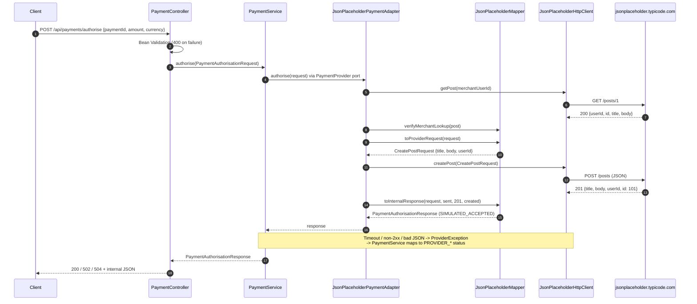

# Payment Adapter POC (Java 21 + Spring Boot, JSONPlaceholder simulation)

> **SIMULATION ONLY.** The external "provider" is [JSONPlaceholder](https://jsonplaceholder.typicode.com),
> a free fake REST API. It is **not** a payment processor, it **does not persist** POST requests (every
> `POST /posts` returns `id: 101`), and it **cannot authorise payments**. This service never reports a
> payment as authorised: the success status is `SIMULATED_ACCEPTED`, every response has
> `"simulation": true`, and every message starts with `SIMULATION ONLY` or `SIMULATION FAILED`.

The POC shows how an internal payments API maps a request to an external API, makes a **real HTTPS
call**, and maps the actual provider response back into a consistent internal format.

## Run it

Prerequisites: **JDK 21** and internet access to `jsonplaceholder.typicode.com`. Maven is optional
(the Maven Wrapper `./mvnw` is included and downloads Maven 3.9.9 from Maven Central on first use;
if Central is blocked on your network, use an installed `mvn` 3.9+ instead: `mvn test`, `mvn spring-boot:run`).

```bash
./mvnw test             # 29 tests, all offline (a local fake server stands in for JSONPlaceholder)
./mvnw spring-boot:run  # starts on http://localhost:8080
```

Or build a jar: `./mvnw package && java -jar target/payment-adapter-poc-0.0.1-SNAPSHOT.jar`.

Configuration lives in `src/main/resources/application.yml`; any value can be overridden on the
command line, e.g. `--payments.jsonplaceholder.read-timeout=2s`.

| Property | Default | Meaning |
|---|---|---|
| `payments.provider` | `jsonplaceholder` | Which `PaymentProvider` adapter the core service uses |
| `payments.jsonplaceholder.base-url` | `https://jsonplaceholder.typicode.com` | Provider base URL |
| `payments.jsonplaceholder.merchant-user-id` | `1` | JSONPlaceholder user/post that stands in for our merchant account |
| `payments.jsonplaceholder.connect-timeout` | `3s` | TCP/TLS connect timeout |
| `payments.jsonplaceholder.read-timeout` | `5s` | Per-request timeout |

## Try it

### Happy path

```bash
curl -i -X POST http://localhost:8080/api/payments/authorise \
  -H 'Content-Type: application/json' \
  -d '{"paymentId":"PAY-1001","amount":1250,"currency":"GBP"}'
```

Response (`HTTP/1.1 200`):

```json
{
  "paymentId": "PAY-1001",
  "providerReference": "JSONPLACEHOLDER-POST-101",
  "status": "SIMULATED_ACCEPTED",
  "message": "SIMULATION ONLY - JSONPlaceholder returned HTTP 201 and assigned post id 101. No payment was authorised: JSONPlaceholder is a fake REST API, not a payment processor, and it does not persist POST requests.",
  "provider": "jsonplaceholder",
  "simulation": true
}
```

Application log (captured from a real run; the provider bodies are exactly what JSONPlaceholder returned):

```text
INFO  PaymentService            : Internal request received: {"paymentId":"PAY-1001","amount":1250,"currency":"GBP"}
INFO  JsonPlaceholderHttpClient : >>> Outgoing HTTP GET https://jsonplaceholder.typicode.com/posts/1 body=<none>
INFO  JsonPlaceholderHttpClient : <<< Incoming HTTP 200 from GET https://jsonplaceholder.typicode.com/posts/1 (155 ms) body={
  "userId": 1,
  "id": 1,
  "title": "sunt aut facere repellat provident occaecati excepturi optio reprehenderit",
  "body": "quia et suscipit\nsuscipit recusandae ..."
}
INFO  JsonPlaceholderHttpClient : >>> Outgoing HTTP POST https://jsonplaceholder.typicode.com/posts body={"title":"SIMULATED payment authorisation PAY-1001","body":"paymentId=PAY-1001;amountMinorUnits=1250;currency=GBP","userId":1}
INFO  JsonPlaceholderHttpClient : <<< Incoming HTTP 201 from POST https://jsonplaceholder.typicode.com/posts (102 ms) body={
  "title": "SIMULATED payment authorisation PAY-1001",
  "body": "paymentId=PAY-1001;amountMinorUnits=1250;currency=GBP",
  "userId": 1,
  "id": 101
}
INFO  PaymentService            : Final mapped internal response: {"paymentId":"PAY-1001","providerReference":"JSONPLACEHOLDER-POST-101","status":"SIMULATED_ACCEPTED",...,"simulation":true}
```

### Invalid internal request → `400`

```bash
curl -i -X POST http://localhost:8080/api/payments/authorise \
  -H 'Content-Type: application/json' \
  -d '{"paymentId":"","amount":0,"currency":"pounds"}'
```

```json
{"error":"VALIDATION_FAILED","details":["amount must be greater than 0","currency must be a 3-letter ISO 4217 code","paymentId must not be blank"]}
```

No provider call is made.

### Provider HTTP error → `502`

Point the adapter at a path that 404s on the real API:

```bash
./mvnw spring-boot:run -Dspring-boot.run.arguments="--payments.jsonplaceholder.base-url=https://jsonplaceholder.typicode.com/does-not-exist"
# same curl as the happy path
```

```json
{"paymentId":"PAY-1001","providerReference":null,"status":"PROVIDER_ERROR","message":"SIMULATION FAILED - JSONPlaceholder returned HTTP 404 for GET /posts/1. No payment was authorised.","provider":"jsonplaceholder","simulation":true}
```

### Provider timeout → `504`

```bash
./mvnw spring-boot:run -Dspring-boot.run.arguments="--payments.jsonplaceholder.read-timeout=5ms"
```

```json
{"paymentId":"PAY-1001","providerReference":null,"status":"PROVIDER_TIMEOUT","message":"SIMULATION FAILED - JSONPlaceholder did not respond to GET /posts/1 in time. No payment was authorised.","provider":"jsonplaceholder","simulation":true}
```

Malformed provider responses (non-JSON, wrong JSON shape, empty body, missing `id`, body that does not
echo what we sent) map to `INVALID_PROVIDER_RESPONSE` / `502`. JSONPlaceholder never returns those, so
they are covered by unit tests against a local fake server rather than a live demo.

## Sequence



## Architecture

```text
src/main/java/com/example/paymentadapter
├── api/
│   ├── PaymentController.java          POST /api/payments/authorise, internal status -> HTTP status
│   └── ApiExceptionHandler.java        400 for invalid / unreadable requests
├── payment/                            INTERNAL MODEL + CORE (knows nothing about any provider)
│   ├── PaymentAuthorisationRequest     internal request DTO {paymentId, amount (minor units), currency}
│   ├── PaymentAuthorisationResponse    internal response DTO {paymentId, providerReference, status, message, provider, simulation}
│   ├── PaymentStatus                   SIMULATED_ACCEPTED | PROVIDER_ERROR | PROVIDER_TIMEOUT | PROVIDER_UNAVAILABLE | INVALID_PROVIDER_RESPONSE
│   ├── PaymentProvider                 the port every adapter implements
│   ├── ProviderException               adapter failure with a Reason (HTTP_ERROR, TIMEOUT, UNAVAILABLE, MALFORMED_RESPONSE)
│   └── PaymentService                  selects adapter by `payments.provider`, maps failures, logs final response
└── provider/jsonplaceholder/           EVERYTHING JSONPlaceholder-specific
    ├── dto/CreatePostRequest           provider request DTO {title, body, userId}
    ├── dto/PostResponse                provider response DTO {id, userId, title, body}
    ├── JsonPlaceholderMapper           pure functions: internal <-> provider
    ├── JsonPlaceholderHttpClient       JDK java.net.http client: timeouts, logging, status + JSON handling
    ├── JsonPlaceholderPaymentAdapter   orchestrates GET /posts/1 then POST /posts
    └── JsonPlaceholderProperties       base URL, merchant id, timeouts
```

### How the formats are transformed

**Request** (`JsonPlaceholderMapper.toProviderRequest`):

| Internal field | Provider field | Example |
|---|---|---|
| `paymentId` | `title` = `"SIMULATED payment authorisation " + paymentId` | `SIMULATED payment authorisation PAY-1001` |
| `paymentId`, `amount`, `currency` | `body` = `paymentId=…;amountMinorUnits=…;currency=…` | `paymentId=PAY-1001;amountMinorUnits=1250;currency=GBP` |
| (config) `merchant-user-id` | `userId` | `1` |

**Response** (`JsonPlaceholderMapper.toInternalResponse`):

| Provider data | Internal field |
|---|---|
| (from internal request) | `paymentId` |
| `id` | `providerReference` = `JSONPLACEHOLDER-POST-<id>` |
| HTTP 2xx + valid body that echoes our `title`/`body` | `status` = `SIMULATED_ACCEPTED` |
| HTTP status + `id` | `message` (always prefixed `SIMULATION ONLY`) |

**Errors** (`JsonPlaceholderHttpClient` → `ProviderException` → `PaymentService`):

| Failure | `ProviderException.Reason` | Internal `status` | HTTP to caller |
|---|---|---|---|
| Non-2xx from provider | `HTTP_ERROR` | `PROVIDER_ERROR` | 502 |
| Connect or request timeout | `TIMEOUT` | `PROVIDER_TIMEOUT` | 504 |
| DNS / connection refused / TLS | `UNAVAILABLE` | `PROVIDER_UNAVAILABLE` | 502 |
| Empty / non-JSON / wrong shape / missing `id` / no echo | `MALFORMED_RESPONSE` | `INVALID_PROVIDER_RESPONSE` | 502 |

The `GET /posts/1` call stands in for a "merchant account lookup" before authorising: the adapter checks
the returned post has `userId` equal to the configured merchant id. If it fails, no POST is sent.

## Tests

| Test class | Covers |
|---|---|
| `JsonPlaceholderMapperTest` | request mapping, response mapping, missing `id`, null body, no-echo, merchant lookup checks |
| `JsonPlaceholderHttpClientTest` | real HTTP against a local JDK `HttpServer`: request body sent, unknown fields ignored, 500/404, invalid JSON, JSON array, empty body, timeout, connection refused |
| `JsonPlaceholderPaymentAdapterTest` | GET-then-POST order and exact wire body; no POST when lookup fails |
| `PaymentServiceTest` | every `Reason` → internal status, success passthrough, unknown provider fails fast |
| `PaymentControllerTest` | 200 / 502 / 504 mapping, validation 400, malformed JSON 400 |
| `PaymentFlowIntegrationTest` | full Spring context end-to-end with the fake provider |

All tests run offline; only `spring-boot:run` talks to the live API.

## Limitations (honest list)

- **Nothing is authorised, charged, or stored.** JSONPlaceholder fakes writes; `POST /posts` always
  returns `id: 101`, so `providerReference` is the same for every request and cannot be looked up later.
- `GET /posts/1` as a "merchant lookup" is a stand-in to demonstrate a GET; it has no payment meaning.
- No idempotency keys, retries, circuit breaker, persistence, or asynchronous notifications/webhooks,
  all of which a real provider integration needs. A timed-out real payment would be in an
  **unknown** state and require a status query, not a blind retry.
- No request signing or authentication (JSONPlaceholder needs none).
- `amount` is validated as a positive integer in minor units; it is not checked against the
  currency's exponent (e.g. JPY has 0 decimals).
- Full request/response bodies are logged at INFO for demo purposes. A real system must redact
  PII/card data and secrets.
- Only one provider is active at a time (`payments.provider`); see below for routing.

## Adding a second provider (e.g. WeChat Pay API v3) without changing the internal model

The core (`api/` and `payment/`) only depends on `PaymentAuthorisationRequest`,
`PaymentAuthorisationResponse` and the `PaymentProvider` port. A new provider is a new package that
implements the port; nothing in the core is edited.

1. **Create `provider/wechatpay/`** mirroring the JSONPlaceholder package:
   - `dto/NativePrepayRequest` — WeChat's wire format, e.g.
     `{"appid","mchid","description","out_trade_no","notify_url","amount":{"total","currency"}}`
   - `dto/NativePrepayResponse` — `{"code_url"}` (Native/QR flow) and the error shape `{"code","message"}`
   - `WeChatPayProperties` — `mchid`, `appid`, merchant certificate serial number, private key path,
     APIv3 key, platform certificate/public key, `notify_url`, timeouts.
2. **`WeChatPayMapper`** (pure functions, unit-tested like `JsonPlaceholderMapper`):
   - `paymentId` → `out_trade_no` (WeChat allows 6–32 chars of `[A-Za-z0-9_-|*]`; validate or derive a compliant id)
   - `amount` (minor units) → `amount.total` (WeChat uses fen, i.e. minor units of CNY)
   - `currency` → `amount.currency` (`CNY`; reject others as a mapping error rather than changing the model)
   - response: `code_url`/`out_trade_no` → `providerReference`; WeChat error `code` → `ProviderException` reasons.
3. **`WeChatPayHttpClient`** — same responsibilities as `JsonPlaceholderHttpClient`, plus v3 security:
   sign each request (`Authorization: WECHATPAY2-SHA256-RSA2048 mchid=…,nonce_str=…,signature=…,timestamp=…,serial_no=…`),
   verify the `Wechatpay-Signature` headers on responses, and treat a failed verification as
   `MALFORMED_RESPONSE`. The official `wechatpay-java` SDK can replace this hand-written client.
4. **`WeChatPayPaymentAdapter implements PaymentProvider`** with `name()` returning `"wechatpay"`.
   Spring discovers it automatically; `PaymentService` already receives `List<PaymentProvider>`.
5. **Select it** with `payments.provider=wechatpay`. To run both providers side by side, replace the
   single-provider lookup in `PaymentService` with a small routing rule (e.g. by currency or merchant
   config). That is a routing change, not a model change: request/response DTOs stay identical.
6. **Payment notifications** (WeChat's async `notify_url` callback, AES-256-GCM encrypted with the
   APIv3 key) belong in a provider-specific controller inside `provider/wechatpay/` that translates the
   callback into the same internal status vocabulary.

One honest caveat: `PaymentStatus` is deliberately simulation-only (no `AUTHORISED`). A real provider
would need real outcome values such as `PENDING_CUSTOMER_ACTION` (WeChat Native returns a QR `code_url`
and the payer completes later), `AUTHORISED` and `DECLINED`. Those are provider-neutral additions made
once to the internal vocabulary, not WeChat-specific fields; the request/response shape is unchanged.
