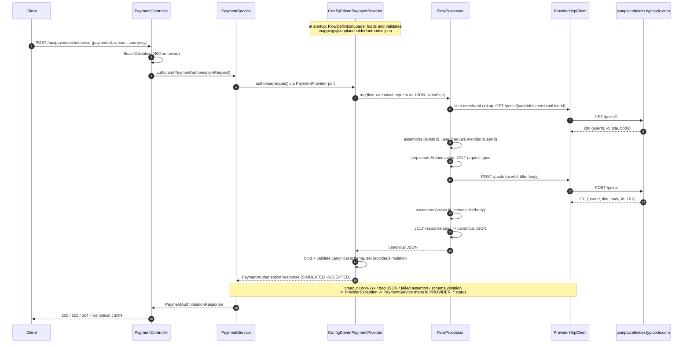

# Payment Adapter POC: configuration-driven provider mapping (Java 21, Spring Boot, JOLT)

> **SIMULATION ONLY.** The external "provider" is [JSONPlaceholder](https://jsonplaceholder.typicode.com),
> a free fake REST API. It is **not** a payment processor, it **does not persist** POST requests (every
> `POST /posts` returns `id: 101`), and it **cannot authorise payments**. This service never reports a
> payment as authorised: the success status is `SIMULATED_ACCEPTED`, every response has
> `"simulation": true`, and every message starts with `SIMULATION ONLY` or `SIMULATION FAILED`.

The POC shows how an internal payments API maps a canonical request to an external API, makes a **real
HTTPS call**, and maps the actual provider response back into the canonical format. **All provider
mapping is configuration**: one JSON flow file per provider per flow, using
[JOLT](https://github.com/bazaarvoice/jolt) for the transformations. That means a Product Owner can
define or change a mapping without writing Java. No Java class refers to a provider field.

## Run it

Prerequisites: **JDK 21** and internet access to `jsonplaceholder.typicode.com`. Maven is optional
(the Maven Wrapper `./mvnw` is included and downloads Maven 3.9.9 from Maven Central on first use;
if Central is blocked on your network, use an installed `mvn` 3.9+ instead: `mvn test`, `mvn spring-boot:run`).

```bash
./mvnw test             # 36 tests, all offline (a local fake server stands in for JSONPlaceholder)
./mvnw spring-boot:run  # starts on http://localhost:8080
```

Or build a jar: `./mvnw package && java -jar target/payment-adapter-poc-0.0.1-SNAPSHOT.jar`.

## Try it

```bash
curl -i -X POST http://localhost:8080/api/payments/authorise \
  -H 'Content-Type: application/json' \
  -d '{"paymentId":"PAY-1001","amount":1250,"currency":"GBP"}'
```

Response (`HTTP/1.1 200`):

```json
{
  "paymentId": "PAY-1001",
  "providerReference": "JSONPLACEHOLDER-POST-101",
  "status": "SIMULATED_ACCEPTED",
  "message": "SIMULATION ONLY - JSONPlaceholder returned HTTP 201 and assigned post id 101. No payment was authorised: JSONPlaceholder is a fake REST API, not a payment processor, and it does not persist POST requests.",
  "provider": "jsonplaceholder",
  "simulation": true
}
```

Application log from a real run (provider bodies are exactly what JSONPlaceholder returned):

```text
INFO  PaymentService     : Internal request received: {"paymentId":"PAY-1001","amount":1250,"currency":"GBP"}
INFO  ProviderHttpClient : >>> Outgoing HTTP GET https://jsonplaceholder.typicode.com/posts/1 body=<none>
INFO  ProviderHttpClient : <<< Incoming HTTP 200 from GET https://jsonplaceholder.typicode.com/posts/1 (155 ms) body={
  "userId": 1,
  "id": 1,
  "title": "sunt aut facere repellat provident occaecati excepturi optio reprehenderit",
  "body": "quia et suscipit\nsuscipit recusandae ..."
}
INFO  FlowProcessor      : Flow 'authorise' step 'createAuthorisation': JOLT mapped canonical request to provider request {"userId":1,"title":"SIMULATED payment authorisation PAY-1001","body":"paymentId=PAY-1001;amountMinorUnits=1250;currency=GBP"}
INFO  ProviderHttpClient : >>> Outgoing HTTP POST https://jsonplaceholder.typicode.com/posts body={"userId":1,"title":"SIMULATED payment authorisation PAY-1001","body":"paymentId=PAY-1001;amountMinorUnits=1250;currency=GBP"}
INFO  ProviderHttpClient : <<< Incoming HTTP 201 from POST https://jsonplaceholder.typicode.com/posts (242 ms) body={
  "userId": 1,
  "title": "SIMULATED payment authorisation PAY-1001",
  "body": "paymentId=PAY-1001;amountMinorUnits=1250;currency=GBP",
  "id": 101
}
INFO  FlowProcessor      : Flow 'authorise': JOLT mapped provider response(s) to canonical response {"paymentId":"PAY-1001","status":"SIMULATED_ACCEPTED","providerReference":"JSONPLACEHOLDER-POST-101","message":"SIMULATION ONLY - ..."}
INFO  PaymentService     : Final mapped internal response: {"paymentId":"PAY-1001","providerReference":"JSONPLACEHOLDER-POST-101","status":"SIMULATED_ACCEPTED",...,"provider":"jsonplaceholder","simulation":true}
```

### Error cases (all verified against the live API)

| Scenario | How to reproduce | HTTP | `status` |
|---|---|---|---|
| Invalid internal request | `-d '{"paymentId":"","amount":0,"currency":"pounds"}'` | 400 | `{"error":"VALIDATION_FAILED","details":[...]}` (no provider call) |
| Provider HTTP error | `./mvnw spring-boot:run -Dspring-boot.run.arguments="--payments.providers.jsonplaceholder.base-url=https://jsonplaceholder.typicode.com/does-not-exist"` | 502 | `PROVIDER_ERROR` — "jsonplaceholder returned HTTP 404 for GET /posts/1" |
| Provider timeout | `./mvnw spring-boot:run -Dspring-boot.run.arguments="--payments.providers.jsonplaceholder.read-timeout=5ms"` | 504 | `PROVIDER_TIMEOUT` |
| Provider unreachable | `--payments.providers.jsonplaceholder.base-url=http://127.0.0.1:1` | 502 | `PROVIDER_UNAVAILABLE` |
| Malformed / unexpected response, failed assertion, or a mapping that doesn't fit the canonical schema | covered by unit tests (JSONPlaceholder never returns these) | 502 | `INVALID_PROVIDER_RESPONSE` |

Every error response looks like
`{"paymentId":"PAY-1001","providerReference":null,"status":"PROVIDER_ERROR","message":"SIMULATION FAILED - ... No payment was authorised.","provider":"jsonplaceholder","simulation":true}`.

## How the configuration works

### 1. Provider settings (`application.yml`, owned by ops/engineering)

```yaml
payments:
  provider: jsonplaceholder                 # which provider the core routes to
  providers:
    jsonplaceholder:
      base-url: https://jsonplaceholder.typicode.com
      connect-timeout: 3s
      read-timeout: 5s
      simulation: true                      # forces "simulation": true on every response
      mapping-location: classpath:mappings/jsonplaceholder/   # or file:/etc/payments/mappings/jsonplaceholder/
      variables:                            # exposed to mappings as variables.<name>
        merchantUserId: 1
```

Adding another entry under `payments.providers` creates another provider at startup.

### 2. Flow file (`mappings/<provider>/<flow>.json`, owned by the Product Owner)

[`src/main/resources/mappings/jsonplaceholder/authorise.json`](src/main/resources/mappings/jsonplaceholder/authorise.json)
defines the whole `authorise` flow:

```text
{
  "flow": "authorise",
  "steps": [                                   // executed in order
    { "name": "merchantLookup",
      "method": "GET", "path": "/posts/{variables.merchantUserId}",   // {dot.path} placeholders from the context
      "assertions": [ { "rule": "exists", "path": "steps.merchantLookup.response.id" },
                      { "rule": "equals", "path": "steps.merchantLookup.response.userId",
                        "otherPath": "variables.merchantUserId" } ] },
    { "name": "createAuthorisation",
      "method": "POST", "path": "/posts",
      "request": [ ...JOLT spec: context -> provider request body... ],
      "assertions": [ ...response must contain id and echo title/body... ] }
  ],
  "response": [ ...JOLT spec: context -> canonical response... ]
}
```

Every JOLT spec reads one JSON **context** that grows as the flow runs:

```json
{
  "request":   { "paymentId": "PAY-1001", "amount": 1250, "currency": "GBP" },
  "variables": { "merchantUserId": 1 },
  "steps": {
    "merchantLookup":      { "request": null, "status": 200, "response": { "userId": 1, "id": 1, "...": "..." } },
    "createAuthorisation": { "request": { "title": "...", "body": "...", "userId": 1 },
                             "status": 201, "response": { "id": 101, "...": "..." } }
  }
}
```

**Request mapping** (step `createAuthorisation.request`): `shift` copies canonical fields into the
provider shape, `modify-overwrite-beta` builds `title`/`body` with `=concat(...)` and converts `userId`
with `=toInteger`, and `remove` drops temporary fields.

**Response mapping** (`response`): `shift` picks `request.paymentId`, the POST's HTTP status and the
provider's `id`, `default` sets `status: SIMULATED_ACCEPTED`, and `modify-overwrite-beta` builds
`providerReference` (`JSONPLACEHOLDER-POST-101`) and `message`.

**Assertions** turn provider responses that are 2xx but wrong into `INVALID_PROVIDER_RESPONSE`.
Rules: `exists` (path has a value) and `equals` (two paths have the same value, compared as text).

### 3. What stays in code (generic, provider-agnostic)

| Component | Responsibility |
|---|---|
| `FlowDefinitionLoader` | Reads flow files at **startup**, rejects unknown properties (typos), invalid methods/rules and invalid JOLT specs, so a broken mapping fails at boot, not on the first payment |
| `FlowProcessor` | Runs the steps: resolve path placeholders, apply JOLT, call HTTP, record the exchange in the context, evaluate assertions, apply the response JOLT |
| `ProviderHttpClient` | JDK `HttpClient`; bodies are plain JSON maps; logs method/URL/body and status/body; turns timeouts, non-2xx, unreachable hosts and unparseable JSON into `ProviderException` |
| `ConfigDrivenPaymentProvider` | Implements the `PaymentProvider` port; binds the mapped JSON to `PaymentAuthorisationResponse` and validates it (**guardrails below**) |

**Guardrails a mapping cannot bypass:**
- The result must bind to the canonical schema. Unknown fields or a `status` outside `PaymentStatus`
  (which has no `AUTHORISED` value) are rejected.
- `paymentId`, `providerReference`, `status` and `message` are required (Bean Validation).
- `paymentId` must match the request.
- `provider` and `simulation` are set by the platform from configuration, overriding anything the mapping sets.

## Sequence



## Project layout

```text
src/main/java/com/example/paymentadapter
├── api/                         PaymentController (status -> HTTP), ApiExceptionHandler (400s)
├── payment/                     CANONICAL MODEL + CORE (no provider knowledge)
│   ├── PaymentAuthorisationRequest / PaymentAuthorisationResponse / PaymentStatus
│   ├── PaymentProvider          port implemented by providers
│   ├── PaymentProviderRegistry  providers by name
│   ├── ProviderException        HTTP_ERROR | TIMEOUT | UNAVAILABLE | MALFORMED_RESPONSE
│   └── PaymentService           selects provider, maps failures, logs final response
└── provider/config/             GENERIC CONFIG PROCESSOR
    ├── ProvidersProperties, ConfigDrivenProviderConfiguration
    ├── FlowDefinition, FlowDefinitionLoader, CompiledFlow
    ├── FlowProcessor, JsonPaths, ProviderHttpClient
    └── ConfigDrivenPaymentProvider
src/main/resources/mappings/jsonplaceholder/authorise.json    <- the only JSONPlaceholder-specific artefact
src/test/resources/mapping-fixtures/*.json                    <- PO-editable mapping tests
```

## Product Owner workflow: changing or adding a mapping

1. Edit `mappings/<provider>/<flow>.json`, or point `mapping-location` at a `file:` folder so the
   mapping can change without rebuilding the jar (it is still loaded at startup, so restart the service).
2. Add or update a fixture in `src/test/resources/mapping-fixtures/`. Each fixture gives a context, the
   mapping to apply (`target` = a step name or `response`) and the exact expected JSON:
   ```json
   { "mappingLocation": "classpath:mappings/jsonplaceholder/", "flow": "authorise",
     "target": "createAuthorisation",
     "context":  { "request": {...}, "variables": {...}, "steps": {} },
     "expected": { "title": "...", "body": "...", "userId": 1 } }
   ```
3. Run `./mvnw test`. `MappingFixturesTest` runs every fixture, and `FlowDefinitionLoaderTest` and
   app startup reject structurally invalid files.

The [JOLT demo site](https://jolt-demo.appspot.com) is useful for experimenting with specs.

## Tests (36)

| Test class | Covers |
|---|---|
| `MappingFixturesTest` | data-driven: each JSON fixture's mapping output matches exactly |
| `ConfigDrivenPaymentProviderTest` | shipped flow against a fake server: GET-then-POST order and exact wire body; merchant mismatch / lookup 503 stop before POST; missing `id`; no echo; unexpected JSON shape; mapping that tries `AUTHORISED`; missing required canonical field; platform overrides `provider`/`simulation` |
| `FlowDefinitionLoaderTest` | valid file loads; invalid JOLT operation, misspelled property, missing file rejected |
| `ProviderHttpClientTest` | real HTTP to a local JDK `HttpServer`: body sent, GET without body, 500, invalid JSON, empty body, timeout, connection refused |
| `JsonPathsTest` | dot paths, list indexes, URL-encoded placeholders |
| `PaymentServiceTest` | every failure reason → canonical status; unknown provider fails fast |
| `PaymentControllerTest` | 200 / 502 / 504, validation 400, malformed JSON 400 |
| `PaymentFlowIntegrationTest` | full Spring context end-to-end with the fake provider |

## Limitations (honest list)

- **Nothing is authorised, charged or stored.** JSONPlaceholder fakes writes and always returns `id: 101`.
- `GET /posts/1` stands in for a "merchant lookup" only to demonstrate a GET in the flow.
- JOLT `com.bazaarvoice.jolt:jolt-core:0.1.8` is the de-facto standard, but its last release was in 2022.
  The mapping engine sits behind `FlowProcessor`, so it could be swapped (e.g. for JSONata) without
  touching the core.
- JOLT is structural. Conditional logic, such as mapping provider error codes to statuses, is possible
  with JOLT shift matching but hard for non-engineers to read. HTTP error mapping, request signing,
  idempotency keys, retries and async webhooks are **not configurable yet**: transport errors are
  mapped generically in code, and signing (e.g. WeChat Pay) would need a pluggable "auth strategy" chosen in config.
- Flow files are loaded at startup; there is no hot reload or mapping versioning/approval workflow.
- Assertions only support `exists` and `equals`.
- Full request/response bodies are logged at INFO for demo purposes. A real system must redact PII and secrets.
- Only one provider is active at a time (`payments.provider`).

## Adding a second provider (e.g. WeChat Pay API v3)

The canonical model (`payment/`) and the processor (`provider/config/`) stay unchanged:

1. Add `payments.providers.wechatpay` in `application.yml` (base URL `https://api.mch.weixin.qq.com`,
   timeouts, `simulation`, `mapping-location: classpath:mappings/wechatpay/`, and variables such as
   `appid`, `mchid`, `notifyUrl`).
2. Write `mappings/wechatpay/authorise.json` with one step, `POST /v3/pay/transactions/native`, and two
   JOLT specs. The request spec maps `request.paymentId` to `out_trade_no`, `request.amount` to
   `amount.total` (fen) and `request.currency` to `amount.currency`, and takes `appid`, `mchid` and
   `notify_url` from `variables`. The response spec maps `code_url` (or `out_trade_no`) to
   `providerReference`. Add assertions like `exists steps.prepay.response.code_url`.
3. Add fixtures for both specs.
4. Set `payments.provider=wechatpay`.

What config cannot express today, and would be added once to the generic processor rather than per provider:
- **Request signing and response verification.** WeChat v3 needs an
  `Authorization: WECHATPAY2-SHA256-RSA2048 ...` header and verification of `Wechatpay-Signature`.
  This would be an `auth` strategy named in the provider settings (e.g. `auth: wechatpay-v3`) and
  implemented once in code.
- **Async payment notifications** (AES-256-GCM encrypted callbacks to `notify_url`). These would be an
  inbound flow file mapped with the same JOLT approach.
- **Real outcome statuses.** `PaymentStatus` is deliberately simulation-only. A real provider would need
  provider-neutral values such as `PENDING_CUSTOMER_ACTION` (WeChat Native returns a QR `code_url`),
  `AUTHORISED` and `DECLINED`, added once to the canonical schema.
